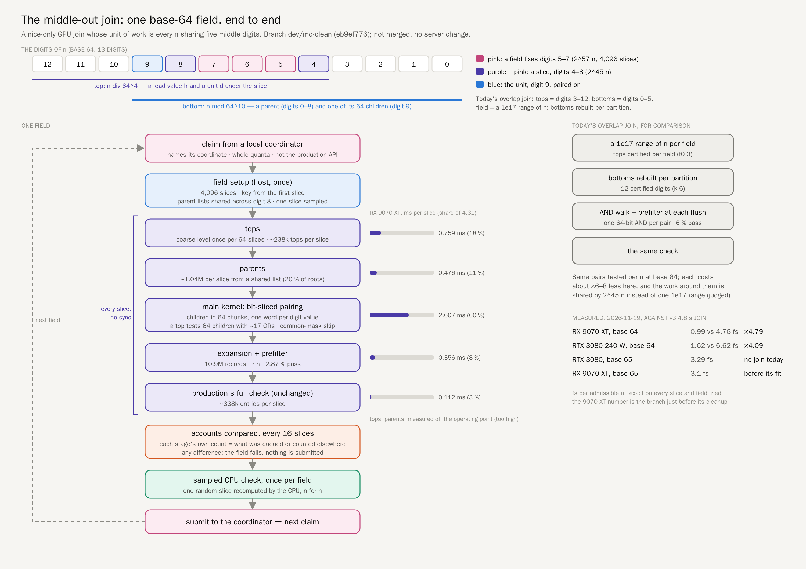

# The middle-out join: design

*A description of what is on the branch and why, for a reader who knows the project and today's overlap join and
has seen none of this work. Written 2026-11-19, kept current; it describes the fork branch `dev/mo-mode` at head
`0b6e22e1` (every file:line below is at that head) and the
measurements recorded beside it. The open decisions are not repeated here; they are in
`~/projects/nice/scratchpad/2026-10-research-program/DECISIONS.md`, and the answers already given in `DECIDED.md`
beside it.*

*How it reaches clients (your direction of 2026-11-25): as a client mode `nice_client midout` beside `detailed`
and `niceonly`, with its own endpoints and tables on the server. The mode is built (§6.11); the server side is a
written proposal awaiting your yes (`…/2026-10-research-program/G2/PROPOSAL-B.md`), and no server code exists.*

*Since the commit this text describes, the branch has moved to `f503a13c` (2026-11-27). What changed, with the
evidence in `…/2026-10-research-program/EXPERIMENTS.md` (entries LINT.1, B65.4, B65.5): (1) the middle-out kernels are
under the WGSL lint in CI; (2) on the wide path, the bottom side's parent lists are shared across a slice digit as
on the narrow path, and the tops stage keeps a compact list: base 65 is 5–6 % faster on an RTX 3060, exact on
CUDA, Vulkan and Metal; (3) after an independent review, **every list that a kernel appends by a subgroup ballot
or plane scan, on both paths, now has a second count kept lane by lane, which the host compares with the list's
own** (before, a driver that split a plane after a branch could have dropped an entry from five such lists with
consistent counts; no driver in use is known to do that). Line numbers below are still those of `0b6e22e1`; the
document is re-based when this series of changes to the wide path is finished.*



The interactive map (`interactive/midout-map.html`, one file, open it in a browser) shows every stage with its
cost, its check and its file:line; this document is the prose behind it.

**Labels.** Every claim carries one:

- **[measured]**: observed in a run on hardware or in a test, with the date and where the raw data is;
- **[proven]**: follows from the definitions (an argument you can check on paper);
- **[judged]**: an estimate, a model or an opinion. A number computed from measured ones (a model, a sum, a
  ratio across sessions) is judged, and says what it rests on.

Terms are defined where they first appear and collected in §10. Unless a section says otherwise, everything is
base 64 (n in [2^75, 2^76), 13 digits, positions 0–12).

---

## 1. The idea in one page

**What the overlap join does today.** A field is a contiguous range of n (1e17 at base 64). The join splits n
into a *top* (a prefix, n div b^f0) and a *bottom* (n mod b^k) with f0 = 3 and k = 6, so top and bottom overlap in
digits 3–5. A top is kept if the digits of n² and n³ at positions ≥ k are the same for every n under it and
distinct (its *certificate*, a digit mask); a bottom is kept if the low k digits of r² and r³ are distinct. A pair
whose masks are disjoint survives, goes through the middle-digit prefilter and then the full check. Inside one
1e17 field the bottoms (12 output digits) are rebuilt per partition and the tops (prefixes of 3 fewer digits)
are certified per field.

**What the middle-out join changes.** Three things, each needing the one before it:

1. **The unit of work is a *slice*: every n of the base that shares five middle digits, positions 4–8** (a
   30-bit value called `pip` in the code). A slice is 2^45 n spread over the whole leading range of the base, not
   a contiguous piece of it. [proven: a slice fixes digits 4–8 and leaves 0–3 and 9–12 free]
2. **Tops and bottoms are built once per slice, for that whole span.** The shape is (f0 4, k 10): a top is
   n div 64^4 (digits 4–12), certified by n², n³ at positions ≥ 10; a bottom is n mod 64^10 (digits 0–9),
   certified by the low 10 digits of r², r³ (20 digits). They share digits 4–9; the slice fixes 4–8, so the only
   shared digit left to pair on is digit 9, the *unit* `d` (64 values). Bottoms are made as 64 *children* of each
   depth-9 *parent* (digits 0–8), and a child adds two digits that are affine in `d`, so the deepest digit costs
   two additions, not a search. Bottoms carry 20 certified digits instead of today's 12. [proven]
3. **Pairing is bit-sliced.** Children are sorted and cut into *chunks* of 64; each chunk is transposed into one
   64-bit word per digit value ("which of these 64 children has digit v"). A top tests 64 children at once by
   OR-ing the words of its ~17 certified digits: a zero bit is a disjoint pair. A chunk whose common digits meet
   the top's mask is skipped with one AND. [proven: the word is exactly the disjointness test for 64 pairs]

**Why that is faster** [judged, from the measured counts below]: the number of (top, bottom) pairs tested is
about the same as today's at base 64 (the shapes that would test fewer are too expensive to build, §6.1), but
each pair costs about ×6–8 less, because a pair is 1/64 of a word built from shared loads instead of an AND in a
walk, and because the per-n work around the pairs (bottoms, tops, survivors) is spread over a slice of 2^45 n
instead of a 1e17 range. Fewer survivors reach the check: 11.8M per slice of 4.47e12 admissible n, and 2.87 % of
those pass the prefilter [measured, slice 712012851].

**Why the wide path matters as much as the narrow one** [judged, §8]: base 65, which only the wide path (two-word
masks) searches, holds about 73 % of the probability of a nice number still within reach of this join, and about
73 % of the remaining machine time; nothing after it is within reach. A gain on the wide path is worth about 2.7
times the same gain on the base-64 path.

**The digits of n at base 64, in one picture:**

```
position:   12 11 10 |  9  |  8  7  6  5  4 |  3  2  1  0
            -------- | --- | -------------- | -----------
            lead h   | unit|   slice (pip)  |  low 24 bits
            (16 bits)|  d  |  digits 4-8    |
top    = n div 64^4  = digits 4..12   certified by n^2, n^3 at positions >= 10
bottom = n mod 64^10 = digits 0..9    certified by the low 10 digits of r^2, r^3
parent = digits 0..8 (one per valid r4 = n mod 2^24, under the slice's digits 4-8)
child  = parent + d * 64^9           (its digits 9 of r^2, r^3 are affine in d)
field (coordinate 4,8,5) fixes digits 5-7: 4,096 slices (digit 4 x digit 8)

today's overlap join at base 64: top = digits 3..12, bottom = digits 0..5, field = a 1e17 range of n
```

**Where it stands** [measured]: base 64 on the RX 9070 XT, 0.99 fs per admissible n against 4.76 fs for v3.4.8's
join, **×4.79** (2026-11-19, on the trunk just before the cleanup, `66259bb0`); the cleaned code on 2026-11-25,
**×4.51** on the median of five rounds (×4.33–4.78), with the maintainer's desktop in use. RTX 3080 at 240 W ×4.09
(1.62 against 6.62 fs); RTX 3060 3.23 fs (×4.1) and Apple M4 through Metal 12.9 fs (×3.9), both against scaled
baselines; GTX 1060 3 GB 8.77 fs. Exact on every device. Base 65, which production has no join for: 3.29 fs on the
3080 (2026-11-20) and 3.12 fs on the RX 9070 XT (2026-11-19); a second run on the RX 9070 XT ran the card at half
clock, for a reason now likely found and fixed but not confirmed on that card (§9). The real `midout` client has
searched real base-64 fields on the RTX 3060 and the M4 against the development server (§6.11).
(*fs per admissible n*: card time divided by the n whose residue mod b − 1 is one of the base's possible
residues for a nice number; 8 of 63 at base 64.) §8 has the table and the conditions.

---

## 2. The pipeline for one field, stage by stage

A field at base 64 is 4,096 slices. The library entry point is `midout::gpu::search_field`
(`common/src/midout/gpu.rs:3953`), which calls `field_run` (`:4072`). The stage table in `gpu.rs:11–18` is the
code's own summary; this section expands it.

**Costs** are ms per slice, measured on field 77777 by *cumulative timing stops* (the bench runs the field's
kernels up to a stage and nothing after; a stage's cost is the difference between two stops):

- **RX 9070 XT** (demoux, RADV, 64 lanes, 2026-11-19 14:10, trunk `66259bb0`, raw:
  `G2/build4s/window_1119/s_*.log`). Tops and parents were measured with the card at about 1.55 GHz and 90 W,
  because those stages alone do not load it; they are not at the operating point and are too high, which makes
  the main kernel's difference too low by the same amount. Tops + parents + main kernel together (stop 3) is
  3.843 ms; the whole slice is 4.312 ms; both of those ran loaded.
- **RTX 3080 at 240 W** (2026-11-19 09:20–09:42, parents shared, raw: `G2/build5l/raw/m2/`). The cleaned head
  has the same per-stage times to within noise (`G2/CLEAN-NOTES.md` §5).

| stage | runs | RX 9070 XT ms (share) | RTX 3080 ms (share) | guarded by |
|---|---|---|---|---|
| 0. field setup: slice list, sampled slice, key, shared parent lists | host, once per field; device for the lists | (host wait 0.14–0.23 s per field, measured; lists ~0.002 ms per slice, judged from instruction counts) | (in parents) | field is whole quanta; shape fits; list account |
| 1. tops | device, `tops5` once per 64 slices, the rest per slice | 0.759 (17.6 %), off the operating point | 0.393 (5.2 %) | `A_T1_*`, `A_TSCAN`, `A_T2_PLACED`, `A_TDIG`, `A_TREC` |
| 2. parents | device, per slice (over a list shared by 64 slices) | 0.476 (11.0 %), off the operating point | 0.525 (6.9 %) | `A_H2_*`, `A_SCAN16`, `A_SCAT`, `A_HSORT`; children counted here |
| 3. main kernel | device, per batch of classes | 2.607 (60.5 %) | 5.542 (73.2 %) | `A_JOBS`, `A_PROBES` = 8 × tops, `A_CHILD` = stage 2's count |
| 4. expansion + prefilter | device, per batch | 0.356 (8.3 %) | 1.108 with stage 5 (14.6 %) | cubes done, slabs walked, bits read = stage 3's survivors |
| 5. full check (production's, unchanged) | device, per batch | 0.112 (2.6 %) with stage 6 | (in stage 4) | its `ran` words: entries = list length, index sum |
| 6. done, group read | device word; host once per 16 slices | (in stage 5) | (in stage 4) | `A_DONE`; slices done = slices queued |
| 7. sampled CPU check | host threads during the field (up to 4 since 2026-11-20); one device rerun at the end | 9.2 s on one thread per 18.5 s field (2026-11-19); host never waited | one thread: 27 s per 30.6 s field; four threads: 7.6–11.6 s per 31.6 s field, device time unchanged; rerun +0.4 to +1.1 % | the slice's counts and its list, n for n |
| **whole slice** | | **4.312** | **7.568** | |

### Stage 0. Field setup (host)

- **In:** `(Coord, v_start, v_size)`. **Out:** the field's list of 4,096 slice keys, the sampled slice, the 8 key
  digits, the shared parent lists.
- `field_run` refuses anything but base 64, shape (4, 10), whole quanta, groups of 1–256 slices
  (`gpu.rs:4081–4093`; 256 because the per-unit counters are 32-bit, `:4088`). `Coord::field_digits`
  (`coord.rs:283`) turns the v range into the values t of the fixed digits; `Shape::slices_of` (`cpu.rs:105`)
  lists each t's slices, digit 4 innermost, so 64 consecutive slices share digits 5–8.
- **The key**: the 8 digits that order the parents (frequent digits in the tops' certificates first) come from
  the field's first slice, computed on the host by `slice_tops` (`gpu.rs:2372`, `:4133`). Any key is exact; the
  key only changes how many chunks the skip removes. [measured: kept fraction on one slice 0.1963 with the field's
  key against 0.1960 with its own]
- **The shared parent lists** (`build_anc`, `gpu.rs:2861`, kernel `anc8_kernel` `:942`): when the field's slices
  take at most 64 values of digits 4–7, each more than once (true for every field of the default coordinate),
  64 lists of depth-4 roots are built at once, one per value of digits 4–7. 870 MB of card memory.
- **The sampled slice**: one slice drawn at random (`RandomState` hashed with `v_start`, `:4110–4125`) is handed
  to a host thread that runs the CPU reference on it, on up to 4 threads since 2026-11-20 (same result, order
  included), (`cpu_slice`, `:3888`) while the card works.

### Stage 1. Tops (device; `dtops` module, `gpu.rs:1828–2202`)

- **In:** the slice key `pip`. **Out:** the slice's tops sorted into segments by (unit, class), their certified
  digits in two forms, and production's 8-word top records for the check.
- A *top* here is a lead value h in [2^15, 2^16) and a unit d: 2^21 prefixes per slice, each covering 2^24 n.
  About 238,000 of them certify (11 %) [measured, slice 712012851].
- `tops5_kernel` (`:1920`) runs **once per 64 slices** (one value of digits 5–8): it certifies the 2^21 coarser
  prefixes n div 2^30 over their 2^30 n and lists the valid ones (19.4 %). `tops1_kernel` (`:1960`) certifies a
  slice's tops only under those (a finer interval keeps every digit its parent certified: exact by
  containment [proven]). `tscan` (`:2033`, one cube) scans the segment counts, `tops2` (`:2084`) scatters into
  segments, `tdigz2` (`:2124`) writes each top's digits as 6-bit fields (`tdig`), `toprec2` (`:2169`) writes
  production's top records.
- The certificate arithmetic is in 32-bit limbs and shifts (`cert_pow`, `:1879`); the host's version
  (`top_cert_b64`, `:2291`) is tested against the CPU reference on 20,000 prefixes [measured].
- **MAXPOP 17** (`gpu.rs:147`): no top at base 64 can certify more than 17 digits (only digits 17–25 of n² and
  30–37 of n³ can agree at both ends of a 2^24-wide interval with n ≥ 2^75) [proven, written at the constant];
  every slice seen has a 17-digit top, so there is no margin, and an 18-digit top would be an error of the field,
  not a lost survivor.

### Stage 2. Parents (device; `prep` module, `gpu.rs:874–1392`)

- **In:** the 9.30M *depth-4 roots* (values r4 = n mod 2^24 whose digits 0–3 of r², r³ are distinct; uploaded
  once per process) or the slice's shared list. **Out:** the *parent records*, sorted by (class, key), and `pseg`,
  the class boundaries.
- A *parent* is r = r4 + pip·2^24, the depth-9 bottom; it is valid when digits 0–8 of r² and r³ are 18 distinct
  digits (`parent()`, `:895`). About 1.04M per slice [measured]. Its record (`par`, one 16-byte vector,
  `gpu.rs:32–37`): the 64-bit mask, `r4` (24 bits), and `cacc` = the two digits and two step sizes from which
  each of its 64 children's digit 9 of r² and r³ follow: `(c2 + a2·d) mod 64`, `(c3 + a3·d) mod 64`.
- `hist2_kernel` (`:1020`) tests each root (over the shared list: 20.3 % of the roots [measured, field 77777]),
  `scan16` (`:1296`) scans, `scatter3` (`:1129`) moves the records and **counts the children of every listed
  parent** (`child_count`, `:1107`; used by the conservation law below), `hsort` (`:1174`, 16,128 buckets = 63
  classes × 256 key bytes) sorts each bucket.
- *Class*: n's residue mod 63 (the digit sum mod b − 1). A child's class is its parent's plus d, so one class
  partition of the parents serves all 64 units [proven].

### Stage 3. The main kernel (device; `g2_kernel`, `gpu.rs:283`)

- **In:** parent records, `pseg`, the tops' digit words and segments, the 8 roots, the job list. **Out:**
  *records*, and the *child lists* (every certified child's r4, in order).
- A *job* is (class c, unit d): one cube per job, 63 × 64 = 4,032 jobs per slice, each queued as two instances
  (probes [0, 576) and [576, 1,152); the second exits at once if there are none). A job's *probes* are the tops of
  unit d whose class pairs with c to one of the 8 roots, so every top is a probe of exactly one job per root
  [proven]; mean 473 probes per job, at most 619 seen [measured].
- Phases (the body's `phase 1`…`phase 4` comments, listed in the doc at `:272–279`): **1** append the certified
  children of 256 parents at a time to pending slots and to the job's child list, until 1,024 children (16 chunks)
  are pending; **2** transpose the round's chunks into per-digit 64-bit words with a shuffle transpose and take
  each chunk's common digits from registers; **3a** per probe, list the chunks the common-mask skip keeps; **3b**
  per (probe, chunk) kept, OR the words of the probe's digits: the complement is the *64-pair word*, one *record*
  per nonzero word into the plane's private slab of 256 records; **4** carry the rest to the front.
- Per slice [measured, slice 712012851]: 33.7M children, 529k chunks, 250M flat (probe, chunk) incidences, 123M
  kept after the skip (49 %), 10.9M records (175 MB), 11.77M *survivors* (bits set). A record is 16 bytes: `[top
  index, child-list position of the chunk's first child, word lo, word hi]` (`gpu.rs:58–62`); the top index rides
  in spare bits of the probe table (20 bits, checked by the host).
- Shared memory 21,504 B, 120 registers, 12 waves per SIMD on RDNA4 [measured offline with the AMD compiler].
  Launched in batches of classes: all 63 at once on CUDA and RADV (`Caps::b64`), 4 on lavapipe (its 128 MiB
  binding limit).

### Stage 4. Expansion and prefilter (device; `expand_kernel`, `gpu.rs:1675`)

- **In:** records, child lists, the tops' `thd` and prefilter masks. **Out:** *survivor entries* `(top index,
  r0)` in production's survivor-list layout, `r0 = n mod 2^30`, only for survivors that pass the prefilter.
- For each set bit it reads the child's r4, forms n mod 2^72 from r0 and the top, squares and cubes it, and
  tests the *prefilter*: digits 10 and 11 of n² and n³ are four distinct digits missing both the bottom's 20 and
  the top's certified digits at positions ≥ 12 (`cpu::prefilter`, `cpu.rs:232`, is the definition; the device
  mirrors it). 2.87 % pass [measured]. Two records per lane per step, their loads issued together (`keep_bits2`,
  `gpu.rs:1565`).
- Two arithmetic forms, the same predicate: `pf` (32-bit limbs; CUDA) and `pf24` (24-bit limbs, which RDNA's
  full-rate 24-bit multiplies take; every other runtime). Chosen by the runtime's type (`PrefilterForm`,
  `gpu.rs:2467–2487`); both are run by the tests on every compiler CI uses.

### Stage 5. The full check (production's `cubecl_join::check_kernel`, unchanged)

- **In:** the survivor list and the top records. **Out:** nice numbers. About 338,000 entries per slice.
  Imported, not copied (`gpu.rs:116–118`), with `CheckShape::new(64, 13, 26, 38, 5, 10, 10)`; `n = P·64^5 + r0`
  with `P` from the top record. Shown to rebuild the join's survivors exactly in probe mode [measured, CUDA].

### Stage 6. Done and the group read (host)

- `done_kernel` (`:1793`) adds 1 to the slice's done word and to the group's slice count. Slices are queued back
  to back on one stream with no synchronisation; once per group of 16 slices `finish_group` (`:3506`)
  synchronises, reads every small buffer in one call and runs every comparison (§4). Device buffers are allocated
  once and reused (the stream orders the reuse).

### Stage 7. The sampled CPU check, and the end of the field

- After the last group (`gpu.rs:4221–4266`): every reported nice n must be nice (`arith::unique_digits`, a
  separate implementation) and inside the field; the slices the device reports done must equal the field's slice
  count; then the sampled slice's counts from the field run must equal the CPU's, and the slice is run again
  alone on the device, unshared, and its prefiltered list must equal the CPU's **n for n** (`sample_compare`,
  `:3911`). Any difference is an error for the field. The result is `FieldOutcome` (`cpu.rs:914`): nice numbers,
  `survivors`, `checked`, slices.
- `survivors` and `checked` (survivors after the prefilter) are exact properties of (shape, field): equal on the
  CPU and on every device [measured: field 77777's 48,216,914,309 / 1,384,731,444 on CUDA at 32 lanes and on
  RADV at 64], but not comparable with today's join's counters, which is why telemetry carries the shape's label.

---

## 3. What a field is, and what that commits the project to

**The coordinate** (`common/src/midout/coord.rs`, the only part that would ever reach a server; it knows nothing
of the join). For a base with range [start, end) and digit positions k0 ≤ q0 < k1, write n = h·b^k1 + key·b^k0 +
low with key = digits [k0, k1); then

    v = start + key·(H·b^k0) + (h − h0)·b^k0 + low

with h0 = start div b^k1 and H the number of values h takes. v moves digits [k0, k1) above all the others and
keeps the rest in their order: one to one from the range into [start, start + H·b^k1) [proven; tested on random n
and both ends].

**The default at base 64 is (k0, k1, q0) = (4, 8, 5)** (`coord_digits`, `coord.rs:105`; `Coord::is_known`, `:181`, also accepts the older one): v is n with bits
24–47 (digits 4–7) moved up to bits 51–74, an exact bit permutation of [2^75, 2^76), no padding. A *quantum* is
H·b^q0 = 2^57 n: all n whose digits 5–7 take one value t. **A field is a whole number of quanta**, i.e. the n whose
digits 5–7 lie in a range [t0, t1), every other digit free. One quantum is 4,096 slices; 262,144 per base. A field
is written `(base, v_start, v_size)`; `range_size` on the wire is `n_count` (`coord.rs:307`), which differs from
v_size only at padded bases. The first coordinate, (4, 9, 6), fixing digits 6–8, is still known and searched.

**What that commits the project to:**

1. **Once a base's first field is handed out, its coordinate is fixed for that base.** A field is a set of n;
   fields cut along other digits are not unions of finished fields, so re-cutting a partly searched base leaves
   partly searched fields. The choice stays free per base, and between bases. [proven] (An earlier review and an
   earlier description said fields "can be re-cut later without redoing any search"; that is false as stated
   and is corrected by this paragraph. Which definition of a field is used stays open until closer to merging, as you asked on 2026-11-25: `DECIDED.md`.)
2. **Fields are no longer intervals of n.** Anything that assumes they are breaks for base 64: "searched up to
   n = X", interval queries over the fields table, the stride path, today's join as a route. Every ordinary claim
   path must refuse such a field; the branch adds that refusal to the client (`wire::refuse_coordinate_space`,
   called from `client_api_async.rs`), and a server would need the matching filter. [proven]
3. **No field smaller than a quantum** (2^57) without a new coordinate. [proven: a v range inside a quantum cuts
   through the leading digits]

**What it leaves free** (each a change inside `midout/` only, never a field row):

- the join's shape: any (f0, k) with f0 ≤ 5 and k ≥ 9 can search a (4, 8, 5) field slice by slice
  (`Shape::fits`, `cpu.rs:90`) [proven]; the CPU reference searches the same small-base fields with two shapes
  and gets the brute-force answer with each [measured];
- chunking, key, sort, kernels, plane width, mask width, prefilter, device;
- work shared between slices inside a field: digits 4 and 8 are free inside a (4, 8, 5) field, so tops share
  across digit 4 (`tops5`) and parents across digit 8 (the shared lists). This is why 5–7 was chosen over 6–8:
  fixing 6–8 scatters the 64 slices that differ only in digit 8 over 64 fields. [proven; worth −3.1 %, measured]
- splitting a field across devices, or resuming part-way (slices are independent and their counters add).
- **Today's overlap join could still search such a field** by restricting its tops to the field's digits, at about
  ×1.9 of its normal cost without its leading-digit prune [judged, `G2/fs/REVIEW.md` §6]. So the commitment is
  to a set of n per field, not to this join.

**How much the field definition can cost at all** [judged]: only tops and parents depend on it (13 % of a slice at
base 64, 23 % at base 65, from measured stage times), so no other grouping of the same work can be more than
×1.15 (b64) or ×1.30 (b65) faster. For the long version: `G2/fs/REVIEW.md` (§1 and §2; its re-cutting sentence is
the one corrected above).

---

## 4. How the code knows the work ran

**The problem** [measured]: every counter starts at zero, and an all-zero slice is a legal result (slice 0 has no
survivors). On CUDA under CubeCL 0.10, a failed allocation panics on the runtime's own thread and every later
launch that binds the missing buffer silently does nothing; `sync()` still returns Ok. Before the accounts, a
failed allocation, a stop variable left in the environment, a dropped kernel, a dropped probe and a dropped parent
all produced `Ok` with fewer or zero survivors; all passed the plumbing checks of the time.

**The accounts** (`A_*`, one 20-word buffer per slice; table in `gpu.rs:11–18`, constants `:164–193`, compared in
`check_slice`, `:3680–3752`, and `finish_group`, `:3506–3673`): every stage writes **positive evidence of its own
work**, and the host compares it with a number it queued or a number another stage counted:

| stage | evidence | compared with |
|---|---|---|
| `tops5` | cubes done | its grid (8,192) |
| `tops1` | valid parents examined; tops certified | `tops5`'s list length; `tscan`'s total |
| `tscan`, `scan16` | ran | 1 |
| `tops2`, `tdigz2`, `toprec2` | rows written | the tops certified |
| `hist2` | cubes done; parents certified, counted by a ballot apart from the list | its grid; the list length |
| `scatter3` | rows moved; **children of the listed parents** | the list length; the main kernel's children |
| `hsort` | cubes done | 16,128 |
| main kernel | job instances finished; probes run; children seen | instances queued; **8 × tops**; `scatter3`'s count |
| expansion | cubes done; slabs walked; **survivor bits read** | 4,096; slabs used; **the main kernel's survivors** |
| check | entries checked, and their index sum | list length, n(n − 1)/2 |
| done | slice done; group's slice count | 1; slices queued |
| any kernel | plane-width error, guards (`C_ERR_*`) | 0 |

**The two conservation laws** tie stages together: the children the main kernel saw equal the children
`scatter3` counted from the same parents, and the survivor bits the expansion read equal the bits the main kernel
wrote. A plane sum with a lane-0 add is self-checking against a partly filled plane. [proven that each law holds
for a correct run; measured to hold exactly on every slice run, including a 100-slice sweep]

**What each catches** [measured by fault injection, `audit.rs`, on CUDA at 32 lanes and lavapipe at 8, and at
64 lanes on the RX 9070 XT]: a dropped main kernel ("job instances done: 0, want 8064"), dropped tops, a dropped
probe per job (−0.21 % of survivors), a dropped parent, a failed device allocation (9,216 MiB filled: "expansion
ran 0 of 4096 cubes"), a dropped shared-list build, a stop variable in the environment (now ignored by the
library), a lost record, a stale slab count, every cap overrun. No failed account is retried: it is an error for
the field, and the client submits nothing.

**The sampled CPU check** (`GpuOptions::cpu_check`, `gpu.rs:3816`; stage 7) is the only thing that sees a kernel
that does all its work and computes wrongly: a wrong certificate, a wrong `parent()` mask, a wrong child mask
(`scatter3` uses the same function, so the law holds), a false common-mask skip, a wrong transpose, a slice run
with the wrong digits, a prefilter that rejects too much (shown: `F_PF_DROP` passes every account and fails the
sampled check), a root wrongly left out of a shared list (the rerun is unshared on purpose). With one slice per
field, a defect touching a fraction f of slices is seen after k fields with probability 1 − (1 − f)^k [proven];
f = 1/1,000 is seen with 63 % probability after 1,000 fields, 0.4 % of the base [judged arithmetic].

**What nothing catches:**

- a defect shared by the device and the Rust CPU reference in how they *implement* the join's rules. The rules
  themselves (certificates, classes, pairing, prefilter, coverage of the range by fields) are proved complete
  in Lean since 2026-11-23 for a model that agrees with the Rust reference on 102,603 table comparisons (§7);
  before that they rested on the reference against brute force at bases 10–25 only;
- production's check kernel judging a nice n not nice (production's own exposure, unchanged);
- a defect in slices the sample has not yet drawn;
- the host-tops path (benchmarks only, feature `midout-bench`) has no tops accounts.

Guards on widths (`C_ERR_IDX`: a class of more than 65,536 parents; a top index above 2^20; child-list positions
past the list, clamped; groups ≤ 256 slices) and the nice numbers' membership are listed in `gpu.rs:154–162` and
`:4231–4243`. For the long version: `G2/BUILD-NOTES.md` §10 and the soundness audit `G2/AUDIT-MO.md`.

---

## 5. Data that passes between stages

Written in the code (`gpu.rs:30–71`, and `gpu_wide.rs:40–61` where the wide path differs); summarised:

| between | what | size per slice (b64) |
|---|---|---|
| host → device, once per process | depth-4 roots (r4 values) | 9.30M × 4 B |
| host → device, once per field | key digits (8 words); 64 shared root lists | 870 MB (lists, allocated once) |
| tops → main kernel | `tseg` segments by (unit, `h mod 63`); `tdig` 4 words per top (20 6-bit digit fields, padded with the first digit, at most 17 read); `thd = h | d << 16`; `tmhi` (certified digits ≥ 12) | ~238k tops |
| tops → check | production's top record, 8 words per top | |
| parents → main kernel | parent record `[mask lo, mask hi, cacc, r4]` sorted by (class, key); `pseg` | ~1.04M × 16 B |
| main kernel → expansion | record `[top index, chunk's first child-list position, word lo, word hi]` in slabs of 256; child lists (r4 per certified child) | 10.9M × 16 B = 175 MB; 33.7M × 4 B |
| expansion → check | survivor entry `[top index, r0]`, production's layout | ~338k × 8 B |
| every stage → host | account `acc` (20 words); group counters `cnt` (64 units × 5 + error words + slice count) | |

Peak card memory [judged from buffer sizes and the 3080's measured 5.2 GB peak]: base 64 about 4.9 GB, base 65
about 8.3 GB; both ran on a 10 GB 3080 and on the 16 GB RX 9070 XT [measured].

---

## 6. The design decisions inside the join

Each: the decision, what else was tried or priced, the numbers, why this one. Costs are on the RTX 3080 unless
said; counts come from an exact CPU prototype on real slices.

### 6.1 The shape (f0 4, k 10)

- **Alternatives:** tops at f0 3 (today's); bottoms at k 11; (4, 9); f0 5.
- **Numbers:** f0 ≤ 3 tops cost at least 0.6 fs per admissible n at b64 (2.7 at b62) even if built once per base;
  k ≥ 11 bottoms need at least 5.4e-4 child generations per admissible n at b64 (5.2e-3 at b62) plus sorting
  2.4e-4 stored bottoms; (4, 9) tests ×1.9–2.0 the pairs and kept words of (4, 10) at b64 and b65 [measured
  counts]; f0 5 makes tops free but raises pairs to 6.3e-3 per admissible n [measured]. Pairs per admissible n
  are the product of the top and bottom certificate rates, measured within 10 % of the digit model [measured].
- **Why:** at b64, (4, 10) tests 3.5e-3 pairs per admissible n, exactly today's pruned pair count; nothing cheaper
  to build tests fewer [judged from measured counts]. The gain is per pair, not fewer pairs.
- **Long version:** `G2/RESULTS.md` §3–4.

### 6.2 Five middle digits (4–8) as the slice key

- **Alternatives:** contiguous ranges of n (today's fields); keys on low digits, residues or classes; four or six
  digits.
- **Numbers:** with contiguous ranges the bottoms are rebuilt per field; to keep the gain a range would have to be
  at least 1/10 of the base at b62 and the whole base at b64; with 1e17 fields nothing transfers beyond about ×1.05
  [judged, from measured counts]. Keys on low digits, residues or classes rebuild one side per field [judged]. Five
  digits make a slice 2^45 n: 2.4 ms on a 3080 when first estimated, 7.6 ms now with everything on the card.
- **Why:** the shape needs digits 4–8 fixed and every leading and low digit free inside the unit; that is exactly
  a slice. [proven, given the shape]

### 6.3 Tops on the device, with a hierarchy

- **Alternatives:** tops on the host in parallel with the card (the original plan); tops certified from scratch
  per slice; a further level once per field (f0 6).
- **Numbers:** host tops took 91 ms per slice on one thread and 18–19 ms on a rented box's 5-CPU quota, against a
  5.4 ms main kernel [measured]: the host cannot keep up. On the device, 0.46 ms per slice; with `tops5` once per
  64 slices, 0.36 ms (−0.13 per slice on the field) [measured]. The per-field level would save under 0.01 ms
  [judged]; not built.
- **Why:** the card is the only place fast enough on the hosts the fleet rents.

### 6.4 Parents shared across digit 8

- **Alternatives:** every slice tests all 9.30M roots; a shared parent *order* across the 64 slices (one sort).
- **Numbers:** a slice's parents depend on r mod 2^48, i.e. on digits 4–7 only for the depth-8 part, so one list
  per value of digits 4–7 is exact by containment [proven]. The lists hold 20.3 % of the roots; parents 0.728 →
  0.525 ms per slice; ten fields 1.6706 → 1.6189 fs, **−3.1 %**, every count equal with and without [measured,
  2026-11-19]. A shared order costs +4.2–7.0 % kept words [measured counts]; not built. Price: 870 MB.
- **Why:** it is free once fields fix 5–7 (§3), and measured.

### 6.5 Chunks of 64 and the common-mask skip

- **Alternatives:** no skip; chunks of 16–32; a tree over the chunks; 8-chunk probe lists; no sort, or a sort only
  inside each tile.
- **Numbers:** kept fraction 0.45–0.58 with the probe-weighted key, 0.57–0.77 unordered [measured counts]; chunks
  of 16–32 keep 0.39–0.52 but cost more per word; a tree over chunks visits 1.0–2.0× the flat count [measured
  counts]; sorting only inside a tile destroys the skip (0.58 → 0.72–0.89 kept), an 8-bit key over the whole class
  loses nothing [measured counts]. On the card the skip pays less than its count says: lanes are chunks, skipped
  chunks still occupy lanes, and only 60.5 % of lane slots do work; skip on is 10 % faster than off in the
  hand-written CUDA kernel, and finer 8-chunk lists were slower (5.27 against 4.89 ms) [measured].
- **Why:** 64 is the word and the plane; a chunk of 64 masks with 16–20 digits each shares at most 3–4 digits, so
  no group test removes much more than half [judged from measured densities].

### 6.6 Bit-sliced pairing against table lookups

- **Alternatives:** "four-Russians" byte tables (8 lookups per 64-pair word into a 2,048-entry table built per
  chunk); scalar ANDs per pair.
- **Numbers:** at b64 a table built per chunk is shared by only about 226 probes that survive the skip, so it costs
  8 + 2048/226 = 17.0 lookups per word against 16.4 bit-sliced [judged arithmetic on measured counts]; on a GPU the
  table reads are byte-indexed by lanes holding different probes (bank conflicts) and each table is 16 KB of
  shared memory [judged]. Measured cost of the bit-sliced word in the hand-written CUDA kernel: 32 ps all-in,
  bound by shared-memory issue (17 independent 8-byte loads per word) [measured].
- **Why:** fewer loads per word did not exist at these densities; the word's loads are the ones the transpose
  makes anyway.

### 6.7 The record format and the expansion

- **Alternatives:** the main kernel writes survivor entries itself; records that name the chunk's first parent
  (the host or a search re-walks it); single-bit records carrying the child's r4; u16 child lists.
- **Numbers:** entries written in the main kernel cost it +1.2 ms per slice for 0.67 ms saved after it
  [measured]; the first device expansion of parent-named records (a list kernel and a binary search) took 3.2 ms,
  the current one 0.92 ms (+0.13 ms in phase 1 to write the child lists) [measured]; single-bit records: kernel
  +0.3 ms, expansion +0.14 [measured]; u16 lists would save 67 MB of writes per slice, not built (needs evidence
  that the writes do not hide) [judged]. 92.8 % of records have one bit set [measured].
- **Why:** two ballots and one 16-byte store per record keep the main kernel's inner step short; the expansion is
  then a plain read with no search.
- **Not explained:** on the 3080 the expansion takes 1.1 ms where reading its 175 MB takes about 0.25 ms and its
  arithmetic about 0.2; a timing-only probe puts it at load latency (record → top → child → prefilter → write)
  [judged]. On the RX 9070 XT it measured 0.356 ms.

### 6.8 Where the prefilter sits

- **Alternatives:** no prefilter (every survivor to the check); production's prefilter, which lives inside its
  join walk; the bottom's mask gathered from the parent record.
- **Numbers:** in the expansion, before the list is written: check 2.42 → 0.52 s per field (−0.46 ms per slice),
  expansion +0.24 ms [measured]; gathering the parent's mask instead: 7.16 s against 5.10 s per field [measured];
  32-bit limbs then took the expansion to 4.63 s [measured]; on RDNA the 24-bit-limb form cut the prefilter loop
  from 240 to 197 cycles per wave-iteration [measured offline].
- **Why:** the check costs about 58 ps per entry and the prefilter removes 97 % before it; the expansion already
  holds n's pieces. The definition is production's test at the same digits, using the top's certificate above
  position 11, which is sound for every nice n and at least as strong [proven].

### 6.9 One narrow and one wide device path, not one generic path

- **Alternatives:** a mask-width parameter on the base-64 kernels; one generic kernel.
- **Numbers:** base 64 forced through the wide path costs +3.7 % (1.772 against 1.709 fs) [measured]. 27 % of
  `gpu_wide.rs` is a verbatim copy of `gpu.rs` and 19 host functions exist twice [measured by reading]. A generic
  kernel in CubeCL 0.10 is judged a trap (comptime branching across every kernel, generated code harder to
  verify) [judged].
- **Why:** base 64 pays nothing for width by construction; what the narrow path gains must be ported by hand,
  and the correspondence table at `gpu_wide.rs:63–81` is the map. Not ported: parent sharing, the host-tops
  path. The wide path has its own check kernel (production's holds digits in one 64-bit mask and refuses bases
  above 64), and that kernel has not been independently audited.

### 6.10 Per-stage accounts instead of a retry

- **Alternatives:** today's join's approach (detect a batch that did not run, refit the layout, retry); read back
  every large buffer at start.
- **Numbers:** the accounts cost +2.3 % per slice (7.714 → 7.891 ms), +2.5 % on ten fields; a first form with the
  checks at the end of the main kernel cost 0.55 ms per slice and was replaced by checks once per job before the
  rounds [measured].
- **Why** [judged]: the failures seen are a device that has stopped running launches (no retry helps; the field
  must fail) or a fixed cap (the layout is fixed per base, sized with margin, and an overrun has never been seen).
  A retry would add a second path to verify. Buffer read-back was not built: the accounts catch the same failure
  at the first group [measured].

### 6.11 The client mode `midout`, and a development server until there is a real one

- **Alternatives** (priced in `G2/PROPOSAL.md` §2–4): A, base-64 fields in today's `fields` table as ranges of v;
  B, separate tables and endpoints; C, no server change, a private coordinator. C was built first, behind a hidden
  client flag; since your direction of 2026-11-25 the client follows B (`G2/PROPOSAL-B.md`; not approved).
- **The mode** (`client/src/midout_route.rs`, the wire in `midout/wire.rs`): `nice_client midout` claims `GET
  /claim/midout` and submits `POST /submit/midout` under `--api-base`, in the proposal's §3 shapes (the tests read
  its two JSON examples verbatim; big integers exact). Under `--repeat` the next field is claimed while one is
  searched and the previous submission finishes in the background, so the card does not wait on HTTP; a 204
  ("nothing claimable") waits, 1 s doubling to 256 s. `--gpu-backend auto` takes CUDA where it starts, else the
  wgpu device; `--threads` sets the sampled check's threads; options that do not apply are refused with a sentence
  or ignored with a warning (table: `G2/MODE-NOTES.md` §1). No server-side file changed, and the shared
  `SearchMode` gained no variant: a client-only `ClientMode` carries the mode until the server change lands.
- **The stop rule:** after a failed search, failed accounts, a differing sampled check, a panic (on any thread,
  or in the search) or a refused submission, nothing more is submitted, the submission in flight is finished or
  reported, and the exit is non-zero. A submission is retried with identical bytes for an hour (the claim's
  lifetime) on 5xx, network errors or a reply cut short; `already_recorded` (a lost reply) is success; 409 and 422
  stop the client with the server's message; a claim 404 is one error ("this server does not offer middle-out
  fields"). SIGTERM and SIGINT finish the submission in flight, then exit. A test build (`midout-fault`) refuses
  any address not on the machine. On Apple Metal the mode runs with one warning at start.
- **The development server** (`scripts/midout_coordinator.py`: standard library, 127.0.0.1, a work list and state
  files; not the API) serves the two endpoints with the proposal's eight submission checks in its order, claims
  that expire after `--claim-duration` (default 3600 s), every acknowledgement after an `fsync`; its port of the
  coordinate arithmetic equals the Rust on 2,514 fields. `scripts/midout_audit.py` checks its state against the
  work list. Its predecessor was attacked with fake clients and injected failures on 2026-11-24 (nine defects, four
  of which could have recorded an unsearched field; all fixed; then 4,950 randomized runs without a failure).
  Adapted to the new wire, the harness found one more on 2026-11-25: after a restart, a record read but never
  fsynced was answered `already_recorded`, so a power cut after that reply lost it (fixed, `a38c9f4d`); then 1,500
  randomized runs without a failure, and 300 stress runs with one, a tolerance of the harness under load
  [measured, `G2/MODE-NOTES.md` §5].
- **An independent review** (2026-11-26, `MODE2/REVIEW.md`) found the loop sound (claim and result cannot cross;
  the stop rule holds on every returning path; a retry resends identical bytes), two ways a wrong record could get
  through (a fault-test build could submit to any server; the audit passed a check that disagreed with its canon)
  and seven robustness defects (among them: `auto` had no fallback from CUDA, so the README's command died on the
  M4; a panic on the loop's thread or a SIGTERM dropped the submission in flight; a server outage of about 8.5
  minutes lost each client's last field). All rank-A and rank-B findings and five of seven smaller ones are fixed,
  one commit each with a test or a run on the M4; left: a question for the proposal (the reply's forward
  compatibility) and a test of a temporary `unreachable!` (`MODE2/FIX-NOTES.md` §4).
- **On real cards** [measured, 2026-11-26]: on the RTX 3060, six base-64 fields through the mode, all accepted,
  audit clean, 61 s a field against 59 s in the bench (`EVENTEO/runs/r1-3060/route/`); on the M4, three fields at
  235–237 s with `auto` falling back to Metal, audit clean, and a SIGTERM during a submission in flight finished it
  and exited within 1 s (`MODE2/m4-runs/`).
- **Why:** the server is the maintainer's decision (`DECISIONS.md`, the entry on the server proposal); the mode lets it be made against a client
  that exists, and the development server tests the client's every path without one.

### 6.12 Smaller decisions

- **One stream, one synchronisation per 16 slices** [measured: driver overhead 0.04 ms per slice]. Launch batches
  of 63 classes on CUDA; 21, 9 and 3 classes were slower (32.2, 35.2, 47.6 s against 31.6 s per field) [measured].
- **Jobs over 576 probes run as a second instance**: 1 slice in 1,024 sampled has a 587-probe job (the
  prototype's kernel counted an error there) [measured]; more than 1,152 is an error (never seen).
- **Nice-ness rechecked on the host by a separate implementation** (`arith.rs` deliberately re-implements it: an
  oracle should not reuse the code it checks).

### 6.13 What another order or more skip tests could still buy (counted 2026-11-20: closed)

- **Question:** the pairing is 60 % of a slice; could another order of the children, another skip test, or
  digits that are known only for part of a job remove much of it?
- **Numbers** [measured: exact counts on 10 base-64 and 2 base-65 slices with the CPU reference's own lists; the
  counting model reproduces the card's 60.5 % busy lanes]: a longer key changes nothing after 8 bits (kept 0.492
  → 0.488); the strongest clustering reaches 0.41 but costs lane slots; sorting a job's children by the size of
  their low four digits lets a top discard 50.6 % of visits from its own digits (the next digits of n² and n³
  below its certificate are constant over a chunk), but chunks then share no digit, so this replaces the key's
  skip instead of adding to it, and costs ×1.12; sharing ORs between neighbouring probes gains ×1.13–1.17; a
  perfect skip at any price would gain ×1.99 (91 % of kept visits yield a zero word). At base 65 the best
  combination reaches ×1.35 in counted work and loses once its tables are paid for [judged].
- **Why closed:** the best exact variant is ×1.18 against a bar of ×1.3 set in advance. Wider words per lane
  (128 or 256 children): ×1.09 on the whole kernel on an RTX 3080 by a microbenchmark of the word loop (2026-11-21),
  ×1.10–1.34 predicted for the RX 9070 XT, **×0.73 and ×0.67 measured on that card on 2026-11-25**: dropped by the
  rule set beforehand (at least ×1.35). Sharing the loads of digits that neighbouring probes have in common was
  slower in every form (best ×0.85 on the whole kernel on an RTX 3080): dropped.
- **Long version:** `~/projects/nice/scratchpad/2026-10-research-program/CEIL/NOTES.md` (the argument, with two
  restructurings that fail on paper), `CEIL/RESULTS.md` beside it (the counts), `CW/RESULTS.md` (word width) and `PS/RESULTS.md` (shared loads).

---

## 7. The CPU reference and the tests

- `midout/cpu.rs`: the join, exact, generic over the base (3–128) and the mask word (`u64`, `u128`), slow. It is
  the oracle for the device and for audits, not a route. Its nice numbers equal production's
  `process_range_niceonly` on whole bases 10–29; its survivors equal brute force on every field of bases 10–25
  in one or two shapes each; its roots equal production's residue filter for bases 3–128 [measured]. A mutation
  test of it (27 mutants) left 3 alive after three independent tests were added; since 2026-11-22 two more
  tests (deep-shape tops against their definition; the prefilter at its exemption boundary against full digits)
  kill the one that mattered (an edited prefilter exemption) and a caller-side form of "certificate one position
  too high" that no Rust test caught; **2 survive, both changing only work counters** [measured].
- **The algorithm is proved in Lean** (fork branch `lean/midout`, directory `lean-midout/`, its own README; not
  part of this branch; 2026-11-22 and 23). The reference is written a second time as Lean functions and
  compared with tables generated from this Rust code: 102,603 comparisons, all equal, no disagreement ever met
  (every survivor in order of 9,411 slices at bases 10–25 and of whole slices at bases 30, 40 and 50; the final
  check on 21,077 numbers; residue classes of bases 3–128; at bases 64 and 65 the components: coordinates,
  fields, certificates, unit tops, parents, children, prefilter). Proved about those functions (246 theorems, no
  `sorry`, Lean's three standard axioms, accepted by Lean's independent checker; audited by a reviewer who did
  not write them): **for every base 3–128 with a range, every coordinate the constructor accepts and every set
  of whole-quanta fields covering the range, a number is nice exactly when some field's search returns it; so if
  every field's search returns nothing, the base has no nice number** (`no_nice_of_searched_withDigits`,
  `isNice_iff_mem_fields`, `searchField_complete_wq`, `searchField_sound`). **What that does not cover:** the Rust
  itself, its 384-bit arithmetic, the bit-sliced word (the model states its meaning), mask widths, the GPU
  kernels and drivers. Since 2026-11-24 also proved: each nice number of a field is reported exactly once; and a
  checker program (`lake exe coverage`, 2.6 s for base 64's 262,144 fields) decides whether the fields a
  server accepted cover the base, with a proof that its "yes" is the theorem's hypothesis: so "if each
  recorded search returned what is recorded, the base has no nice number". It does not check that the searches
  ran. No whole base-64 slice has been run through the Lean model (it would take hours).
- Device against CPU: 1,073 real base-64 slices equal n for n in an independent sweep (on the branch as it was on
  2026-11-18, before the accounts and the 5–7 coordinate) [measured]; since then, 100 of them again, the range's
  first and last slices, and every slice of one field under both coordinates [measured].
- Three test tiers (`mod.rs:34–60`): (a) ordinary CPU tests in every `cargo test`, among them the client mode's
  22 tests (`client/src/midout_route/tests.rs`: options and refusals, the loop with stand-ins, and four end to end:
  the real loop and HTTP client against the development server on 127.0.0.1, searching with the CPU reference on
  bases 10 and 20, on Unix with `python3`); (b) eight device tests named `cubecl_midout_*` that CI's lavapipe jobs
  select (both compilers, WGSL and SPIR-V; 3.1–3.7 minutes each on a 5-CPU box, not timed on a GitHub runner),
  also run on the cards of §8; (c) card-only and long tests behind the feature `midout-box-tests`, which CI never
  builds.
- **CI** [measured, fork runs]: the whole matrix passed on `4fff25e7` (16 jobs, among them i686, armv7, arm-musl,
  aarch64 and both macOS jobs; run 45777405453), and the device run on lavapipe and on the macOS runner's Metal
  (45777409152). Three tests had failed on 32-bit and emulated targets, on `dev/mo-clean` too, all in test code
  (`MODE2/FIX-NOTES.md` §1: among them a test that started 231,506 threads, whose memory qemu-user never returns). The two commits after `4fff25e7` (§9, the wide path's
  reads) have not been through CI; `just lint` passes on `0b6e22e1`, and the wide tests pass on an RTX 3060
  through CUDA, Vulkan/WGSL and Vulkan/SPIR-V.

---

## 8. What is measured, and where

All end to end: tops, parents, kernel, expansion, check and the accounts on the card, whole fields of 2^57 n,
against v3.4.8's join (`be9cc923`, which is v3.4.8 plus a version bump; no join code changed between `7e0113fc`
and it) in the same session.

| card, base | middle-out | v3.4.8's join | ratio | date, conditions | exactness evidence | raw data |
|---|---|---|---|---|---|---|
| RX 9070 XT, b64 | **0.99 fs** (runs 0.995, 1.005, 0.971; median) | 4.762 fs | **×4.79** (best ×4.90) | 2026-11-19 13:55–14:29; trunk `66259bb0` (before the cleanup), RADV 64 lanes, 2.82–2.88 GHz, 303 W; five fields per run after a warm-up | 7 slices n for n at 64 lanes (4 through shared lists), wide b40 and b65, fault test, one field with the sampled check; counters equal the 3080's | `G2/build4s/window_1119/` |
| RX 9070 XT, b64, cleaned head | **1.063 fs** (five rounds of five fields: 1.030, 1.004, 1.107, 1.063, 1.099) | 4.794 fs (four bracket fields) | **×4.51** (×4.33–4.78; rounds 1–2 alone ×4.71) | 2026-11-25 03:56–05:52; head `66305ada`, RADV 64 lanes, 2.85–2.93 GHz, 299–303 W (production 3.10–3.13 GHz, 304 W); the desktop in use (load about 3), rounds 3–5 6–10 % slower at the same clock | 7 slices n for n with and without shared lists, parent-sharing test, narrow and wide fault tests, wide b40 and b65, whole field 77777 under (4, 8, 5) and (4, 9, 6) with the sampled check; every count equal to 2026-11-19's | `G2/window_1125/`, `G2/WINDOW3-RESULTS.md` |
| RX 9070 XT, b65, cleaned head | 4.78–4.89 fs, **off the operating point** (1.53 GHz, 112 W): not a result | none | | 2026-11-25 04:16; the same command as 2026-11-19; time outside device waits 7.8 s per field against 1.6 s then | counts equal 2026-11-19's; the sampled check equal and never waited for | `G2/window_1125/out/w65_*.log` |
| RTX 3060 (CUDA), b64 | **3.231 fs** (10 warm fields, 3.206–3.239) | 13.33 fs [two bracket fields, 254.45 s and 287.37 s, scaled by the RX 9070 XT's base mean] | **×4.12** | 2026-11-26 02:47–03:26; head `f61cf79e` (`dev/mo-mode`), an FX-6300 host with five host threads; card 98 % busy, 157 W | the whole card tier on CUDA; counts equal the other devices'; six fields through the real `midout` client with a clean audit | `…/2026-10-research-program/EVENTEO/runs/r1-3060/` |
| RTX 3060 (Vulkan through wgpu, WGSL), b64 | 3.296 fs (one warm field, 60.3 s) | | | 2026-11-26 03:55; the same head and machine; W 32; card 156 W | tier (b) through Vulkan passes; the field's sampled check equal | `…/EVENTEO/runs/r2-vulkan/` |
| GTX 1060 3 GB (CUDA), b64 | 8.774 fs (one field) | not measured | | 2026-11-26; the same head; fits in 3 GB | the field's sampled check equal; counts equal | `…/EVENTEO/runs/r1-1060/` |
| Apple M4 (Metal), b64 | **12.94 fs** (one warm field) | 50.2 fs [one bracket field, 968.92 s, scaled] | **×3.88** | 2026-11-26 02:38–03:05; the same head; macOS 27.2, W 32 | the same six test groups as on CUDA, all pass | `…/MAYALARAN/runs/` |
| RTX 3080 240 W, b64 | **1.619 fs** | 6.615 fs | **×4.09** | 2026-11-19 09:20–09:42; trunk with parent sharing; ten fields at 0.05–0.95 of the base; sampled check on | counts equal with and without sharing, field for field; every sampled slice equal | `G2/build5l/raw/m2/` |
| RTX 3080 240 W, b64, cleanup | head `5a048669` 1.6269 against trunk `66259bb0` 1.6242 (+0.17 %) | | | 2026-11-19 13:58–14:44; four alternating runs each | survivors, checked equal in all eight runs; 80 of 80 sampled checks | `G2/build6c/raw/ten_head`, `ten2_head` |
| RTX 3080 240 W, b65 | **3.468 fs** (×2.17 of b64's 1.600 in the same session) | none (production has no join above 64) | | 2026-11-19 10:21–10:33; five warm fields; sampled check off | slices n for n against the CPU reference incl. both range ends; whole small bases against brute force | `G2/build5l/raw/m4/` |
| RTX 3080 240 W, b65, a day later | **3.290 fs** against 3.655 fs for the head of the day before (−10.0 %) | none | | 2026-11-20 09:41–09:57; head `10ddbf17` against `c2152084`, five warm fields, alternating, on a box 5 % slower than the one above; sampled check on (4 threads) | counts equal in every run; slices n for n incl. both range ends; wide fault test | `G2/build9w/raw/five_d/` |
| RTX 3080 240 W, b64, a day later | 1.769 fs against 1.807 fs for `c2152084` (−2.1 %: device time equal; the threaded check no longer makes the host wait on this box) | | | 2026-11-20, same session | counts equal | `G2/build9w/raw/` |
| RX 9070 XT, b65 | **3.12 fs** (two fields incl. warm-up; 3.02 the warm one) | none | | 2026-11-19 14:16; wide path untuned for this card (since fitted to it offline, not re-run: predicted 2.4–3.0 fs [judged]) | b40 and b65 slices at 64 lanes | `…/window_1119/w_65.log` |
| RTX 3060, b65 | CUDA 6.30, 6.44 fs; Vulkan (SPIR-V) 6.32, 6.36 (trunk `66259bb0`: 6.98, 7.12 and 7.33, 7.25) | none | | 2026-11-26 05:49–08:00; head `f61cf79e`; field 77777 after a warm-up; sampled check off; quiet host | counts equal in every run and to the RX 9070 XT's of 2026-11-25 | `…/B65/runs/`, `B65/RESULTS.md` |
| RTX 3060, b65, reads batched | Vulkan (SPIR-V) quiet 6.191, 6.172 fs (6.381 before); six busy host threads **6.35** (14.25 before) | none | | 2026-11-26 08:03–09:19; `0b6e22e1` against `4fff25e7` | counts equal; wide tests and fault messages identical through CUDA, WGSL, SPIR-V | `…/B65/runs/reads-*`, `B65/READS-RESULTS.md` |

**What the numbers mean for the choice of base** [judged from measured rates and the uniform odds model; table
in `~/projects/nice/scratchpad/2026-10-research-program/YIELD/yield.txt`, 2026-11-26]. Base 65 has about the same
admissible work as base 64 (4.34e21 against 4.80e21 n: only one residue class in 64 can hold a nice number) and
2.7 times its expected count of nice numbers (3.3e-4 against 1.2e-4), so three times the yield per admissible
n. It runs on the wide path at about three times the time per admissible n on the RX 9070 XT (twice on an RTX
3080), so today the two bases tie in yield per day there, and **base 65 is about 73 % of both the probability
still within reach and the remaining machine time** (about 150 days of the RX 9070 XT against 56). Base 68 is
12 times worse than base 64 and nothing after it is within reach. Consequences: the wide path is where a gain
is worth most; on CUDA cards base 65 is already the better buy (×1.5 per card-day), so a fleet of NVIDIA cards
would best take base 65 while the RX 9070 XT takes either.

How the baselines were measured: on the 3080, production's client against a local stub, the same ten 1e17 fields
three times in one day (6.615 fs each time, to 0.1 s). On the RX 9070 XT, production's join throughput harness:
the ten-field mean of 2026-11-18 (4.707 fs, from `7e0113fc`) scaled by two bracket fields measured in the same
session as the middle-out runs (×1.0118). The middle-out's fields each span the whole leading range; today's are
1e17 ranges at ten positions, three of them empty; dividing by admissible n puts both on one scale [judged].
Base 64 on the RX 9070 XT alone at 0.99 fs: about 55 days, against about 266 at 4.76 fs [judged arithmetic].

**The earlier ratios, and why they were wrong** (all reported before 2026-11-18 evening):

- **×8.3 to ×10** (the first model): GPU unit costs at or past the optimistic edge of every measured analogue,
  and one arithmetic error (the table-lookup cost amortised over all probes of a chunk instead of those that
  survive the skip). An independent review corrected it to about ×5 at b64 [judged, then].
- **×5.1** (hand-written CUDA kernel on a 3080), **×4.6** (the portable kernel on a 3080), **×4.7–5.5** (the
  portable kernel on the RX 9070 XT, pre-registered and pipelined): each was the kernel and parent preparation
  measured, **plus an assumed 0.085–0.115 fs for tops and survivor checks**. Once the whole path ran on the card,
  that part measured 0.45 fs (tops 0.10, turning 10.9M records into checkable entries 0.22, the unprefiltered
  check 0.13): about four times the assumption. The first end-to-end number was ×3.78 on the 3080; the
  expansion, the prefilter, the top hierarchy and parent sharing brought it to ×4.09 there. [measured]
- **"The prefilter adds 2.6 ms to the wide expansion"** compared two different kernels on two cards, and the
  conclusion drawn on 2026-11-19 from a second pair (3.64 ms without a prefilter, 3.37 with), that the time was not
  the prefilter, was wrong too: by ablation on 2026-11-20 the prefilter's arithmetic was 1.88 of the expansion's
  3.45 ms; the run without it cost the same only because it wrote 16.5M survivors instead of 0.5M [measured].
- **The size of the branch** was reported as 6,500–7,000 lines; it was 13,525 insertions in 21 files at
  `5a048669` against v3.4.8's `be9cc923`, its merge base with `origin/main`; 14,875 in 22 files at `66305ada` (the
  wide path about 4,600, tests about 2,800) and 17,822 in 27 at `0b6e22e1` [measured by `git diff --stat`].

---

## 9. What is not done, or not known

- **No field has gone through a real server, because there is none.** The mode has run only against the
  development server, on one machine (127.0.0.1). The server proposal is not approved, and it leaves open its five
  sub-decisions (`G2/PROPOSAL-B.md` §7: field size, insertion, double-checking, credit, submit body; each with a
  default) and eight questions that building the client raised (§9 there: big integers as strings in the claim
  too, the type of `nice_numbers`, one shape per base, what counts as the same submission, a 404 that tells an
  unknown claim from a missing endpoint, `matches_canon` in the reply, whether a 503 is waited out, which base is
  handed out first); the review adds one (`MODE2/REVIEW.md` C5: the proposed table's `elapsed_secs` has no field
  in the typed body). Not tested, as only a real server can test them: many clients on many machines, runs of
  days, a database restart. By reading the client [judged]: a searched field's result is held in memory only, so
  a crash, or a server down for more than an hour, loses it, and the field is searched again once its claim
  expires; nothing wrong is recorded.
- **Base 65 on the RX 9070 XT has no result since the wide path was fitted to that card** (2026-11-20, offline
  with the driver's compiler: 120 registers, 21.4 KB of shared memory and 12 waves per SIMD instead of 192, 23.7 KB
  and 8; predicted 2.4–3.0 fs from 3.02 [judged]). On 2026-11-25, with the desktop in use, it ran the card at half
  clock (1.53 GHz, 112 W; 4.8–4.9 fs). **Likely cause** [measured on an RTX 3060 on 2026-11-26; inferred for the
  RX 9070 XT]: the wide driver read its result buffers one blocking read at a time (about 29,600 per base-65 field,
  against about 260 on the narrow path), and through Vulkan each read stalls when the host's CPUs are busy: six
  busy threads made base 65 ×2.3 slower with the card 24 % busy, against +3 % through CUDA. It is not a
  regression (the head is 10–13 % faster than the trunk there). **Fixed in `0b6e22e1`** (one read per group, as on
  the narrow path): under the same load 14.25 → 6.35 fs, 3 % faster on a quiet host, exact, every fault message
  unchanged [measured, RTX 3060, `B65/READS-RESULTS.md`]; **not yet run on the RX 9070 XT.** The narrow path's 6–10
  % slowdown there on 2026-11-25 may share the cause (it lost 5 % under load through Vulkan on the 3060) [judged].
  Further base-65 gains, ranked from a stage profile (`B65/RESULTS.md` §4–5) [judged]: the main kernel (58 % of a
  slice), the wide expansion at the narrow one's cost per record (about 4 %), the shared parent lists ported (about
  5 %), tops queued several slices at a time (up to 10 %); none built.
- **Metal: exact on an Apple M4** (macOS 27.2, through WGSL, plane width 32; 2026-11-26): the device tier, two
  base-64 slices n for n, the fault tests, parent sharing, wide parity at bases 40 and 65; whole fields at 12.94
  fs, about ×3.9 against production's join on the same machine [measured; the ratio from one bracket field]. The
  mode's refusal of Metal is now a warning at start. Not checked: other Apple GPUs, older macOS releases (the
  Metal compiler defect of 2026 miscompiled some divisions by a constant; fixed in the OS), and CubeCL's own MSL
  compiler. The project's WGSL lint for that defect did not cover the middle-out kernels until 2026-11-27; since
  `c16d48e9` two dump tests (`wgsl_dump_for_lint` in `gpu.rs` and `gpu_wide.rs`) put the base-64 and base-65
  kernels through it at plane widths 32 and 64, the CI step fails if one drops out, and **nothing is flagged**
  [measured: fork CI run 45949807997, 58 shaders; a scratch build with the old miscompiled form was flagged]. Not
  under the lint: plane width 16, the wide path at bases 66–70, and what happens after the WGSL (naga's MSL).
- **The sampled check at base 65 depends on free CPUs.** The CPU slice runs on up to 4 threads (33 s on a 5-CPU
  box against a 57 s field; one thread 106 s). The threads cost base 65 +0.7 % of device time and base 64 nothing
  measurable; the check's device rerun costs about 1 s per base-65 field and 0.2–0.4 s at base 64 [measured].
  Thread priority is not lowered.
- **Bases 66–70: partly.** Base 68 was exact on two slices before the paths were merged (2.13 fs on a 20 GB card)
  and has not run since; it needs a 2D tops grid to launch on Vulkan. Bases 69 and 70 have never run; base 70
  needs the (4, 11) shape and a 64-bit slice key. The mode refuses 66–70 (`route.rs:33–56`).
- **Fault bits are a runtime kernel argument** (`fault: u32`, 0 in production), not compile-time; making them
  compile-time changes every faultable kernel's generated code and needs the same verification again. No test
  switch can reach a release build [measured by reading].
- **The older field definition is still in the code.** The review fixes of the first two cut branches are on
  this branch since 2026-11-19 evening (private `Coord` fields with getters, three independent tests, the fixed
  brute-force test, true docs for the default coordinate). What the branch keeps beyond those cut branches: the
  older coordinate (4, 9, 6) as "also known" at bases 64 and 65, and the coordinates of bases 65 and 68–70, which
  the wide path and its tests use. Whether the older one is dropped waits for the choice of the field's definition, which you asked on 2026-11-25 to leave open until closer to merging (`DECIDED.md`).
- **Smaller:** `run_slice` and `run_slice_dev` are public and return one slice, not a field; lavapipe at 16 lanes
  aborts in lavapipe itself; the 3080's unexplained 0.6 ms in the expansion (§6.7); the shared lists are sized
  for 3.4M roots each (an overrun is an error; the longest seen is 1.89M); the mode does not refuse a software
  renderer (that refusal comes with upstream #277, which this branch predates); a few Vulkan processes segfault at exit
  after printing their results (not investigated).

---

## 10. Where the code is, and how to run it

**Branch** `dev/mo-mode` on the fork `wasabipesto-bot/nice`, head `0b6e22e1`: 32 commits on `dev/mo-clean`
`66305ada` (the cleanup, 33 commits on the development trunk `66259bb0`); worktree
`~/projects/nice/.worktrees/mo-mode`. Against v3.4.8's `be9cc923`, its merge base: 27 files, 17,822 lines added, 24
removed. The history before the cleanup stays on `dev/middle-out-join`. No pull request is open from this work, by your instruction of 2026-11-19 and 2026-11-25 (`DECIDED.md`).

| file | lines | what |
|---|---|---|
| `common/src/midout/mod.rs` | 75 | module map; the three test tiers |
| `common/src/midout/coord.rs` | 636 | the work unit: coordinate, quantum, field ↔ fixed digits, `n_count` |
| `common/src/midout/cpu.rs` | 1,654 | the exact CPU reference: shape, certificates, parents, slice join, prefilter, brute-force predicates |
| `common/src/midout/arith.rs` | 138 | 384-bit arithmetic and nice-ness for the reference (re-implemented on purpose) |
| `common/src/midout/mask.rs` | 75 | digit masks generic over `u64` / `u128` |
| `common/src/midout/gpu.rs` | 4,881 | base-64 device path: kernels (`kernels`, `prep`, `post`, `dtops`), driver `GpuJoin`, `search_field`, tests |
| `common/src/midout/gpu_wide.rs` | 4,746 | two-word-mask device path for bases 65–70 (and small bases in tests), its own check kernel |
| `common/src/midout/audit.rs` | 872 | parity sweep and fault injection (tests only) |
| `common/src/midout/route.rs` | 175 | one entry point per base for the client mode, with telemetry |
| `common/src/midout/wire.rs` | 490 | the mode's endpoints, typed claim, submission and reply, their answers; the ordinary-route guard |
| `common/src/cubecl_join.rs` | +2/−2 | two constants (`CHECK_CUBES`, `RAN_WORDS`) made `pub(crate)` so the check's grid and account are shared, not copied |
| `common/src/client_api_async.rs` | +147/−4 | the mode's claim and submit with their retries; the ordinary claim refuses a coordinate-space field |
| `common/src/lib.rs`, `Cargo.toml` | +1, +19 | `pub mod midout`; features `midout-bench`, `midout-box-tests`, `midout-fault` |
| `common/examples/midout_bench.rs`, `midout_wide_bench.rs`, `support/args.rs` | 314, 291, 146 | whole-field timing (feature `midout-bench`); one option reader for the three examples |
| `common/examples/midout_fields.rs` | 88 | a work list of fields for the development server |
| `client/src/midout_route.rs`, `midout_route/tests.rs` | 948, 1,198 | the mode: options, the loop, guards, stop on a signal, panic hook; its tests |
| `client/src/main.rs`, `bench.rs`, `Cargo.toml`; `README.md` | +91/−11, +7/−6, +10/−1; +6 | the mode on the command line (`ClientMode`); the README's lines on it |
| `scripts/midout_coordinator.py` | 586 | the development server (standard library, 127.0.0.1; durable records, a lock, the eight checks) |
| `scripts/midout_audit.py` | 225 | checks a development server's state directory against its work list |

**Run it on one machine** (the `gpu` feature set, as a GPU release; `auto` takes CUDA where it starts, else the
wgpu device):

```sh
cargo build --release -p nice_client --features gpu
cargo build --release -p nice_common --example midout_fields
target/release/examples/midout_fields --base 64 --spread 12 > work.json
python3 scripts/midout_coordinator.py --worklist work.json --state ./mo-state --port 8471
target/release/nice_client midout --api-base http://127.0.0.1:8471 --repeat --username NAME
python3 scripts/midout_audit.py --worklist work.json --state ./mo-state
```

Records land in `mo-state/claims.jsonl` and `mo-state/submissions.jsonl`; `GET /status` gives counts. The timing
bench: `cargo build --release -p nice_common --features cubecl-cuda,midout-bench --example midout_bench`, then
`midout_bench --cuda --fields 13107,77777` (sampled check on by default). Tier (b) tests on a software device:
`cargo test --release --features cubecl -p nice_common -- --ignored cubecl_midout`.

**Terms.** *Slice*: every n sharing digits 4–8. *Unit*: digit 9 (`d`). *Top*: a lead value and unit, i.e. the
prefix n div 64^4 under a slice, with its certified digit mask. *Bottom*: n mod 64^10. *Parent*: a depth-9 bottom
(digits 0–8). *Child*: a parent plus a unit digit. *Class*: residue mod 63. *Job*: (class, unit), one cube.
*Probe*: a top run against a job's children. *Chunk*: 64 consecutive children of a class. *Record*: one nonzero
64-pair word. *Survivor*: a (top, child) pair with disjoint masks and compatible classes. *Quantum*: the smallest
field, 2^57 n at base 64. *Coordinate*: the renumbering v of n that makes fields ranges. *Admissible n*: n whose
residue mod b − 1 can be a nice number's.

**For the long version** (all under `~/projects/nice/scratchpad/2026-10-research-program/G2/`): `RESULTS.md` (the
original design and its cost tables), `REVIEW.md` (the first review of it), `BUILD-NOTES.md` (the build: §2 the
field, §3 decisions, §9–§14 the measured steps), `AUDIT-MO.md` (the soundness audit), `fs/REVIEW.md` (the field
structure), `BUILD-NOTES-CLIENT.md` (the earlier coordinator and route), `MODE-NOTES.md` (the client mode), `BUILD-NOTES-WIDE.md` (bases above 64),
`CLEAN-NOTES.md` (the cleanup), `MAINTAINABILITY.md` and `PR-PLAN.md` (the proposed series of pull requests),
`PR12-REVIEW.md` (the review of the first two), `CARRYBACK-NOTES.md` (that review's fixes brought onto this
branch, with every test tier re-run), `WIDE2-NOTES.md` (the wide path's check, expansion and shared memory,
2026-11-20); beside `G2/`: `MODE2/REVIEW.md` and `MODE2/FIX-NOTES.md` (the mode's review, its fixes and the CI
matrix), `B65/RESULTS.md` and `B65/READS-RESULTS.md` (base 65 on the RTX 3060, the batched reads), and
`EXPERIMENTS.md` for every number with its raw data.
